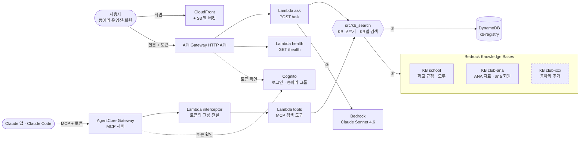
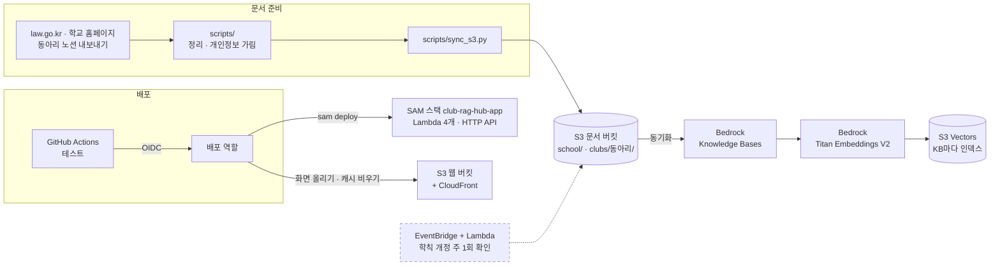

# club-rag-hub

[](https://github.com/JJong2003/club-rag-hub/actions/workflows/deploy.yml)

충남대학교 동아리 운영을 돕는 질의응답 RAG 챗봇입니다. 학교 규정과 동아리 자료를 각각 지식 베이스(Knowledge Base, KB)로 두고, 로그인한 사람이 볼 수 있는 KB만 골라 검색한 뒤 찾은 근거로만 답하고 출처를 붙입니다. 첫 번째로 연결한 동아리는 [충남대학교 ANA](https://anacnu.kr/)입니다.

AWS 서울 리전에서 서버리스로 동작합니다 (Amazon Bedrock, S3 Vectors, Lambda, API Gateway, DynamoDB, CloudFront, Cognito).

## 왜 만드나요

동아리를 운영하다 보면 비슷한 질문이 해마다 돌아옵니다. "행사비를 학교 지원금으로 쓸 수 있나?", "작년 MT는 어떻게 준비했지?" 같은 것들입니다. 그런데 답이 있는 곳은 흩어져 있습니다.

- **학교 규정**: 학칙, 총학생회칙, 동아리 관련 규정이 HWP·PDF 파일로 여러 곳에 있습니다. 규정이 개정되면 지금 보는 파일이 최신인지 알기 어렵습니다.
- **동아리 경험**: 역대 활동 기록과 후일담은 노션 문서나 선배의 기억에 남아 있어서, 운영진이 바뀔 때마다 일부가 사라집니다.

그래서 규정과 동아리 자료를 한곳에 모아 두고, 운영진(행사 기획자 포함)이 평소 말로 물으면 근거 문서를 찾아 답하는 챗봇을 만듭니다.

## 쓰는 방법

| 통로 | 어떻게 | 누가 답을 쓰나 |
|---|---|---|
| **웹 챗봇** (주 화면) | 브라우저에서 로그인하고 질문합니다. 휴대폰에서도 됩니다. | Bedrock의 Claude Sonnet 4.6이 찾은 근거로만 답하고 문장 끝에 [1], [2] 출처 번호를 붙입니다. |
| **MCP 서버** (추가 통로) | Claude 앱이나 Claude Code에 연결해 검색 도구(`list_sources`, `search`, `read_document`)로 씁니다. | 사용자의 Claude가 씁니다. 서버는 근거 문서만 돌려줍니다. |

- 두 통로 모두 같은 Cognito 계정으로 로그인하고, 같은 검색 코드(`src/kb_search`)로 같은 KB를 검색합니다.
- 계정은 관리자가 만들어 줍니다 (가입 없음). 동아리 그룹이 없는 계정은 학교 규정만 검색합니다.

## 무엇을 할 수 있나요

| 할 수 있는 일 | 예시 | 상태 |
|---|---|---|
| 학교 규정 질문 | "동아리방에서 전기난로를 써도 되나요?" | ✅ 동작 |
| 동아리 자료 질문 (그 동아리 회원만) | "총무는 어떤 일을 하나요?" | ✅ 동작 |
| 행사 기획 도움 | 행사 종류·장소·날짜·내용을 적으면 학교에 신청할 것과 비슷한 지난 활동을 함께 찾음 | ✅ 동작 |
| 답변 근거 확인 | 출처 카드에 규정명·조문·개정일과 원문 링크, 동아리 자료는 노션 경로와 연도. 펼치면 근거 원문 | ✅ 동작 |
| Claude 앱·Claude Code에서 검색 (MCP) | 기획안을 쓰다가 규정과 지난 활동을 바로 찾아 씀 | ✅ 동작 |
| 상태 확인 API | `GET /health`: 문서 저장소, KB 목록, 임베딩 모델 연결을 한 번에 확인 | ✅ 동작 |
| 학칙 개정 자동 반영 | 매주 개정 여부를 확인해서 바뀐 조문만 KB에 다시 반영 | 계획 |

근거를 찾지 못하면 지어내지 않고 "관련 규정을 찾지 못했습니다. 학생과나 총동아리연합회에 확인해 주세요."라고 답합니다.

## 특징: KB를 등록하면 바로 연결됩니다

이 서비스의 중심은 **KB 레지스트리**(DynamoDB 테이블 `kb-registry`)입니다. 질의응답 앱은 어떤 KB가 있는지 코드에 적어 두지 않고, 질문이 들어올 때마다 레지스트리를 읽어 검색할 KB를 고릅니다. 그래서 **KB만 준비되면 레지스트리에 한 줄 등록하는 것으로 연동이 끝나고, 앱은 다시 배포하지 않습니다.**

```json
{
  "kb_key": "club-ana",
  "kb_id": "<Bedrock KB ID>",
  "s3_prefix": "clubs/ana/kb/",
  "allowed_groups": ["ana"],
  "chunking": "FIXED_SIZE",
  "enabled": true
}
```

- **새 동아리 추가는 명령 한 줄**: `bash infra/04_add_kb.sh club-xxx clubs/xxx/kb/ FIXED_SIZE xxx "XXX 동아리 운영 자료" "한 줄 설명"`을 실행하면 S3 폴더, 벡터 인덱스, KB, KB 전용 IAM 역할, 레지스트리 항목이 한 번에 만들어집니다. 그다음 자료를 그 폴더에 올리면 됩니다.
- **연합 행사도 설정만으로**: 다른 동아리와 행사를 함께 준비할 때는 상대 동아리 KB 항목의 `allowed_groups`에 우리 그룹을 넣습니다. 그동안은 상대 동아리 자료도 함께 검색되고, 행사가 끝나면 빼면 됩니다.
- **권한에 맞춘 검색**: 학교 규정 KB는 누구나(`*`), 동아리 KB는 그 동아리 회원만 검색합니다. 검색 범위는 로그인 토큰의 Cognito 그룹으로 정하고, KB마다 IAM 역할을 따로 둬서 한 KB가 다른 동아리의 문서나 벡터에 접근하지 못합니다.
- **KB별로 묶어서 답하기**: 모든 KB가 같은 임베딩 설정(Titan Text Embeddings V2, 1024차원, cosine)을 쓰지만, 문서 성격이 달라 KB마다 점수대가 다릅니다. 점수순으로 합치면 학교 규정이 동아리 자료에 밀려 빠지기 때문에, KB마다 4개씩 검색해 KB별로 묶은 뒤 Claude에 넘깁니다.
- **자료 성격에 맞춘 분할**: 학교 규정은 조문 하나를 파일 하나로 나눠 그대로 넣고(NONE), 동아리 자료는 300토큰 단위로 20%씩 겹쳐 나눕니다(FIXED_SIZE).
- **데이터와 앱 분리**: 문서, 벡터, KB, 로그인, 웹 호스팅은 `infra/` 스크립트가 만들고, Lambda와 API는 SAM 스택이 만듭니다. 앱 스택을 지웠다 다시 만들어도 문서와 벡터는 그대로 남습니다.
- **쓰는 만큼만 내는 비용**: 벡터 저장소로 S3 Vectors를 써서 상시 켜 둬야 하는 검색 클러스터가 없습니다. 나머지도 요청 단위로 과금되고(Lambda, HTTP API, DynamoDB 온디맨드), 질문 API는 요청 수를 따로 제한합니다.

## 아키텍처

> 설계가 바뀔 때마다 이 그림을 갱신합니다. 현재 기준: **웹 챗봇 + MCP, 다중 KB**, 2026-11-25. 점선은 아직 만들지 않은 부분입니다.

### 질문할 때



- **웹**: Cognito로 로그인(인가 코드 + PKCE)한 뒤 질문하면, API Gateway가 토큰을 확인하고 ask Lambda를 부릅니다. ① 레지스트리에서 그 사람의 그룹이 볼 수 있는 KB를 고르고, ② KB마다 검색해 KB별로 묶은 뒤, ③ Claude Sonnet 4.6이 근거에 있는 내용만으로 답하고 출처 번호를 붙입니다. 화면은 답변에 실제로 쓰인 출처만 카드로 보여 줍니다.
- **MCP**: AgentCore Gateway가 로그인 토큰을 확인하고, 인터셉터가 토큰의 그룹을 도구 입력에 넣습니다. 도구 Lambda는 웹과 같은 검색 코드로 근거 문서를 KB별로 돌려주고, 답은 사용자의 Claude가 씁니다.

### 문서를 넣을 때와 배포할 때



- **문서가 바뀔 때**: 수집·정리 스크립트가 `data/` 폴더에 S3와 같은 구조로 파일을 만들고, `sync_s3.py`가 바뀐 파일만 올린 뒤 KB 동기화까지 합니다. KB는 Titan으로 임베딩해서 S3 Vectors에 저장합니다. 동아리 자료는 개인정보 가림을 검토한 뒤에 올립니다.
- **배포할 때**: `main`에 앱 코드나 웹 화면이 push되면 GitHub Actions가 테스트(pytest, 웹 화면 시험)를 돌리고, AWS 키 없이 OIDC로 배포 역할을 받아 SAM 스택을 배포한 뒤 `/health`로 확인합니다. 이어서 웹 화면을 웹 버킷에 올리고 CloudFront 캐시를 비운 뒤, 웹 주소와 `/ask`(토큰 없으면 401)를 확인합니다.
- 문서·벡터·KB·로그인·웹 호스팅·MCP 서버 같은 리소스는 배포 때마다 만들지 않고 `infra/` 스크립트로 한 번 만듭니다.

## 저장소 구조

| 경로 | 내용 |
|---|---|
| `infra/` | AWS 리소스 생성(00~09), 배포, 점검 스크립트. 실행 순서와 직접 할 일은 [infra/README.md](infra/README.md) |
| `template.yaml` | SAM 앱 스택: Lambda 4개, HTTP API와 JWT 권한 부여자 |
| `src/kb_search/` | 검색과 근거 답변. 웹과 MCP가 같이 씀 |
| `src/ask/`, `src/health/` | 웹 질의응답 API(`POST /ask`), 상태 확인 API(`GET /health`) |
| `src/tools/`, `src/interceptor/` | MCP 검색 도구, 로그인 그룹 전달 |
| `web/` | 웹 챗봇 화면. 빌드 없는 정적 파일이고 `config.js`는 배포 때 만듦 |
| `scripts/` | 학교 규정·동아리 자료 수집과 정리, S3 업로드 |
| `tests/` | pytest 단위 테스트. AWS를 부르지 않고 가짜 클라이언트로 확인 |

테스트: `python -m pytest`, `node --test web/app.test.mjs` (Python 3.12, Node.js 22 이상)

## 앞으로

- 웹 화면을 다듬고, 시험 질문으로 답변과 그룹별 검색 범위를 점검합니다.
- 학교 문서와 동아리 자료를 더 넣고, 답하지 못한 질문을 모아 빠진 자료를 찾습니다.
- 학칙 개정 자동 반영을 붙입니다.
