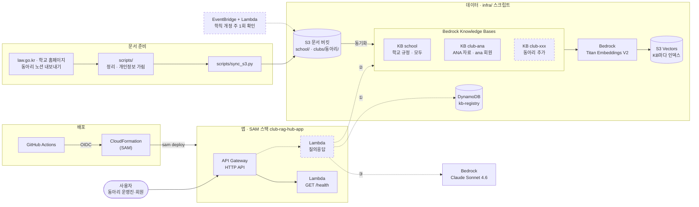

# club-rag-hub

[](https://github.com/JJong2003/club-rag-hub/actions/workflows/deploy.yml)

충남대학교 동아리 운영을 돕는 질의응답 RAG 챗봇입니다. 학교 규정과 동아리 자료를 각각 지식 베이스(Knowledge Base, KB)로 두고, 질문한 사람이 볼 수 있는 KB만 골라 검색한 뒤 근거 문서와 함께 답합니다. 첫 번째로 연결한 동아리는 [충남대학교 ANA](https://anacnu.kr/)입니다.

AWS 서울 리전에서 서버리스로 동작합니다 (Amazon Bedrock, S3 Vectors, Lambda, API Gateway, DynamoDB).

## 왜 만드나요

동아리를 운영하다 보면 비슷한 질문이 해마다 돌아옵니다. "행사비를 학교 지원금으로 쓸 수 있나?", "작년 MT는 어떻게 준비했지?" 같은 것들입니다. 그런데 답이 있는 곳은 흩어져 있습니다.

- **학교 규정**: 학칙, 총학생회칙, 동아리 관련 규정이 HWP·PDF 파일로 여러 곳에 있습니다. 규정이 개정되면 지금 보는 파일이 최신인지 알기 어렵습니다.
- **동아리 경험**: 역대 활동 기록과 후일담은 노션 문서나 선배의 기억에 남아 있어서, 운영진이 바뀔 때마다 일부가 사라집니다.

그래서 규정과 동아리 자료를 한곳에 모아 두고, 운영진(행사 기획자 포함)이 평소 말로 물으면 근거 문서를 찾아 답하는 챗봇을 만듭니다.

## 무엇을 할 수 있나요

| 할 수 있는 일 | 예시 | 상태 |
|---|---|---|
| 학교 규정 질문 | "동아리 지원금은 어디에 쓸 수 있나요?" | 개발 중 |
| 동아리 자료 질문 (그 동아리 회원만) | "작년 신입생 환영회는 어떻게 진행했나요?" | 개발 중 |
| 규정과 동아리 자료를 함께 보는 질문 | "작년처럼 외부에서 MT를 하려면 학교에 무엇을 신청해야 하나요?" | 개발 중 |
| 답변 근거 확인 | 답마다 규정명·조문 번호나 동아리 문서 제목을 함께 표시 | 개발 중 |
| 학칙 개정 자동 반영 | 매주 개정 여부를 확인해서 바뀐 조문만 KB에 다시 반영 | 계획 |
| 상태 확인 API | `GET /health`: 문서 저장소, KB 목록, 임베딩 모델 연결을 한 번에 확인 | ✅ 동작 |

## 특징: KB를 등록하면 바로 연결됩니다

이 서비스의 중심은 **KB 레지스트리**(DynamoDB 테이블 `kb-registry`)입니다. 질의응답 앱은 어떤 KB가 있는지 코드에 적어 두지 않고, 질문이 들어올 때마다 레지스트리를 읽어 검색할 KB를 고릅니다. 그래서 **KB만 준비되면 레지스트리에 한 줄 등록하는 것으로 연동이 끝나고, 앱은 다시 배포하지 않습니다.**

```json
{
  "kb_key": "club-ana",
  "kb_id": "<Bedrock KB ID>",
  "s3_prefix": "clubs/ana/kb/",
  "allowed_groups": ["ana"],
  "chunking": "FIXED_SIZE",
  "enabled": true
}
```

- **새 동아리 추가는 명령 한 줄**: `bash infra/04_add_kb.sh club-xxx clubs/xxx/kb/ FIXED_SIZE xxx`를 실행하면 S3 폴더, 벡터 인덱스, KB, KB 전용 IAM 역할, 레지스트리 항목이 한 번에 만들어집니다. 그다음 자료를 그 폴더에 올리면 됩니다.
- **연합 행사도 설정만으로**: 다른 동아리와 행사를 함께 준비할 때는 상대 동아리 KB 항목의 `allowed_groups`에 우리 그룹을 넣습니다. 그동안은 상대 동아리 자료도 함께 검색되고, 행사가 끝나면 빼면 됩니다.
- **권한에 맞춘 검색**: 학교 규정 KB는 누구나(`*`), 동아리 KB는 그 동아리 회원만 검색합니다. KB마다 IAM 역할을 따로 둬서, 한 KB가 다른 동아리의 문서나 벡터에 접근하지 못합니다.
- **여러 KB의 결과를 하나의 답으로**: 모든 KB가 같은 임베딩 설정(Titan Text Embeddings V2, 1024차원, cosine)을 써서 KB끼리 검색 점수를 비교할 수 있습니다. 앱은 KB마다 검색(Retrieve)한 결과를 점수순으로 합친 뒤 Claude로 답을 만들고, 근거 문서를 직접 붙입니다 (질의응답 Lambda, 개발 중).
- **자료 성격에 맞춘 분할**: 학교 규정은 조문 하나를 파일 하나로 나눠 그대로 넣고(NONE), 동아리 자료는 300토큰 단위로 20%씩 겹쳐 나눕니다(FIXED_SIZE).
- **데이터와 앱 분리**: 문서, 벡터, KB는 `infra/` 스크립트가 만들고, Lambda와 API는 SAM 스택이 만듭니다. 앱 스택을 지웠다 다시 만들어도 문서와 벡터는 그대로 남습니다.
- **쓰는 만큼만 내는 비용**: 벡터 저장소로 S3 Vectors를 써서 상시 켜 둬야 하는 검색 클러스터가 없습니다. 나머지도 요청 단위로 과금됩니다 (Lambda, HTTP API, DynamoDB 온디맨드).

## 아키텍처

> 설계가 바뀔 때마다 이 그림을 갱신합니다. 현재 기준: **설계 v2 (다중 KB)**, 2026-11-23. 점선은 아직 만들지 않은 부분입니다.



- **질문할 때**: API Gateway가 질의응답 Lambda를 부릅니다. Lambda는 ① 레지스트리에서 질문한 사람이 볼 수 있는 KB를 고르고, ② KB마다 검색한 뒤, ③ 결과를 점수순으로 합쳐 Claude에게 넘겨 답을 만듭니다.
- **문서가 바뀔 때**: 수집·정리 스크립트가 `data/` 폴더에 S3와 같은 구조로 파일을 만들고, `sync_s3.py`가 바뀐 파일만 올린 뒤 KB 동기화까지 합니다. KB는 Titan으로 임베딩해서 S3 Vectors에 저장합니다. 동아리 자료는 개인정보 가림을 검토한 뒤에 올립니다. 학칙 개정은 주 1회 Lambda가 확인해서 바뀐 조문만 올릴 예정입니다.
- **배포할 때**: `main`에 앱 코드가 push되면 GitHub Actions가 테스트를 돌리고, AWS 키 없이 OIDC로 배포 역할을 받아 SAM 스택을 배포한 뒤 `/health`로 확인합니다.
